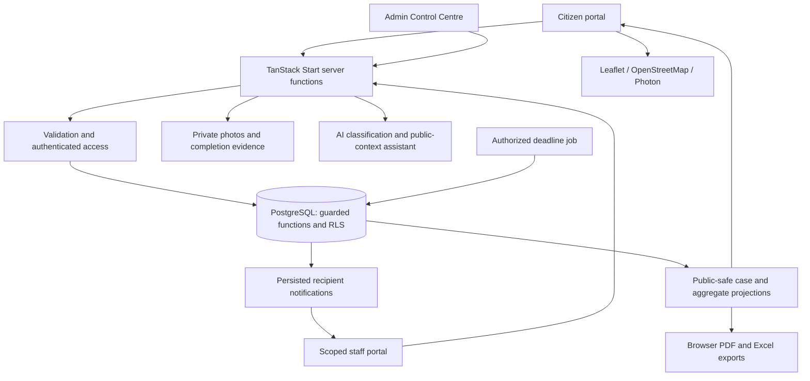

<div align="center">


# Siddhi
### Your City. Your Voice.

**Location-aware civic reporting. Accountable case handling. Visible progress.**

[Open Siddhi](https://siddhifix.lovable.app) · [Explore the product](#product-gallery) · [Architecture](#architecture) · [Run locally](#local-development)

**Developed and deployed by Sudeep, Sudesh S Shetty & Shankar Gadyal**  
**Dayananda Sagar University**

</div>

---

## Why Siddhi?

A civic report should not end at submission. Citizens need to know where their report went, what happens next, and what evidence supports the outcome.

Siddhi connects photo-led reporting and an explicitly chosen incident location with scoped staff workflows, recorded acknowledgements, evidence and citizen feedback. It starts with Bengaluru, with configurable service coverage for future expansion.

> Siddhi is an independent civic platform, not an official government service. Authority names are indicative; configured routing does not imply an authorized government partnership or external delivery.

## Product gallery

### Citizen experience
Report a problem, explore the neighbourhood and follow recorded progress.


<details>
<summary><strong>View reporting, assistant and public-report screens</strong></summary>

### Photo-led reporting
Camera or gallery entry with a separate incident-location confirmation flow. This capture shows the entry screen, not completed GPS acquisition.


### Ask Siddhi
Public-information assistance with typed questions, language controls and optional browser voice input. The image shows the initial assistant screen.


### Public transparency reports
Explicit filters, canonical counting and a shared aggregate snapshot for screen views, PDF and Excel.


</details>

*Actual application screenshots captured on 25 October 2026. Displayed counts are snapshots of recorded activity, not government performance or measured civic impact.*

## Three portals. Clear responsibilities.

| Portal | Who it serves | What it provides |
| --- | --- | --- |
| **Citizen** | Residents; no account required for reporting | Photo submission, manual/GPS incident selection, Civic Map, reference tracking, public updates, confirmation/reopening and feedback |
| **Government Staff** | Authorized handlers and supervisors | Scoped queues, assignment, acknowledgement, ETA, public/internal updates, evidence, notifications and deadline review |
| **Admin Control Centre** | Authorized administrators and owner | Account provisioning, access scopes, teams, routing, service targets, directory review and audit |

Super Admin belongs to the separate administrative control plane—not the operational officer escalation hierarchy.

## Key capabilities

### Reporting and location
- Photo-first entry with private originals and separate display/annotated copies.
- Manual incident selection independent of the device's current position.
- India-wide address suggestions, with Bengaluru service coverage validated separately.
- Shared coverage and ward-boundary checks in location UI and server submission.
- Friendly outside-service-area correction that preserves report work.

### Intelligent triage
- AI-assisted photo/text classification with structured category/severity suggestions and conservative fallback.
- Duplicate candidates using image hashes and contextual category, text, distance and time signals.
- Human-reviewed canonical linking, rejection and audited reversal; original reports are retained.
- Explainable rule-based recurrence and prioritization—not a trained prediction model.
- Visit-only public-context assistant with editable speech transcripts and playback controls.

### Accountable operations
- Active-account and department/category/team/ward/corporation authorization.
- Atomic, audited assignment, acknowledgement and status changes with stale-update checks.
- Completion-evidence prerequisite before guarded resolution.
- Protected reporter confirmation/reopening and feedback.
- Persisted recipient-owned notifications with read/unread/archive state and reconnect recovery.
- Configurable service targets, routing exceptions, overdue review and escalation records.

### Transparency
- Public-safe case history, separate from internal staff notes.
- Ward/category/status views and filtered aggregate reporting.
- PDF and real Excel exports derived from the same public-safe snapshot.
- Source-backed authority information with verified-image requirements and initials fallback.

## How a case moves

```text
Photo + selected incident location
                ↓
Server validation → coverage / ward / configured routing
                ↓
Atomic report + tracking capability + creation event
                ↓
Authorized assignment → acknowledgement → progress
                ↓
Completion evidence → guarded resolution
                ↓
Citizen confirmation → closed
        or dispute → reopened for review
```

Unknown ownership or missing eligible teams stays an explicit exception rather than becoming a guessed government assignment. Exact transitions are enforced by the application's guarded functions.

## Technology stack

| Layer | Technologies used |
| --- | --- |
| Language | TypeScript, SQL |
| Interface | React 19, TanStack Router/Query, Tailwind CSS 4, Radix UI, Lucide |
| Full-stack framework | TanStack Start; Vite 8; edge-targeted server runtime |
| Data and access | Managed PostgreSQL, row-level security, guarded database functions, managed authentication |
| Maps and location | Leaflet, OpenStreetMap tiles, Photon suggestions, browser geolocation, EXIF parsing |
| Intelligence | AI SDK, gateway-based model calls, structured analysis and deterministic review signals |
| Charts and exports | Recharts, pdf-lib/fontkit, ExcelJS, JSZip |
| Validation and tests | Zod, Vitest, Testing Library, PGlite isolated SQL tests |

The classification and assistant source currently configure `openai/gpt-6-astra` through the managed AI gateway. This is a configuration identifier, not a model-accuracy or live-availability claim. Browser speech depends on browser/OS support.

## Architecture



Events can invalidate subscribed views; recovery-safe polling refreshes relevant screens, commonly every 15 seconds. This is not a zero-latency guarantee. External government email/SMS/API delivery is not connected.

## Security and trust

- Citizens submit through validated server functions, not direct anonymous table writes.
- Reporter capabilities are hashed; public case references do not grant reporter decision rights.
- Private photo/evidence storage is accessed through authorized projections and signed media access.
- Staff scope and account activity are enforced beyond the interface.
- Administrative privileges require protected provisioning/delegation, never self-assigned signup metadata.
- Public updates and internal notes remain separate.
- Audited transitions, request limits and human review support accountability without treating every uncertain report as fraud.

Evidence hashes support integrity; they do not independently verify a physical repair. These are implemented safeguards, not an independent security certification.

## Local development

### Prerequisites
- Bun and a current Node.js toolchain.
- Authorized access to the application's managed backend and configuration.
- Server-side AI/provider configuration if those features are required.

```bash
git clone <your-repository-url>
cd <your-repository-folder>
bun install
bun run dev
```

Use the local URL printed by the development server. The application needs its existing database functions, policies and storage configuration; installing packages does not provision the backend.

### Configuration

| Configuration | Scope | Purpose |
| --- | --- | --- |
| `VITE_SUPABASE_URL` | Browser configuration | Managed backend endpoint |
| `VITE_SUPABASE_PUBLISHABLE_KEY` | Browser configuration | Public client key; authorization still relies on policies |
| `SUPABASE_URL`, `SUPABASE_PUBLISHABLE_KEY` | Server configuration where required | Runtime access to the same configured backend |
| `LOVABLE_API_KEY` | Server only | Existing AI-gateway access; never expose to browser code |

Use environment configuration provided by an authorized project owner. Do not commit secrets, session tokens, reporter capabilities or account credentials. Managed privileged credentials are not downloadable from the application. Do not edit generated integration files or assume replacing public variables recreates the backend.

For another hosting environment, verify edge-runtime compatibility, auth callbacks, protected server configuration, private storage, migration/grant application and authorized deadline scheduling before deployment.

### Useful commands

```bash
bun run test       # Full automated suite
bun run dev        # Development server
bun run build      # Production bundle in your local/CI environment
bun run preview    # Preview the generated build
```

## Validation and release status

**Latest executed suite: 260 tests passed across 35 files, 25 October 2026 UTC.**

Coverage includes location/coverage rules, role and scope checks, case lifecycle, evidence validation, notifications, duplicate/demo safeguards and report exports. These include isolated database tests; they are not all hosted end-to-end checks.

Previous acceptance documents record platform build success and signed-in workflow checks. A fresh production bundle, published-worker acceptance, provider-load evaluation and complete physical-phone workflow were not repeated during this README update. No users-served, AI-accuracy, repair-rate or time-saved claims are made.

### Remaining operational dependencies
- Verified real teams, asset ownership and current officer contact/photo coverage.
- Authorized external government delivery integrations.
- Complete target-phone GPS, camera, voice and browser acceptance.
- Complete localization/accessibility review; English/Hindi/Kannada support is not universal across every screen.
- Detailed premium staff exports, large-export performance and production monitoring.

The manifest/icons support installation where the browser permits it; there is no service-worker-backed offline workflow guarantee.

## Project structure

```text
src/
  routes/                 Citizen, staff, admin and server routes
  components/             Product views and shared controls
  lib/                    Validation, workflows, intelligence and exports
  integrations/           Generated managed-backend clients and auth helpers
  test/                   Unit, permission and isolated SQL regression tests
drizzle/migrations/       Application schema, policies and guarded functions
public/                   Manifest, icons and ward import data
docs/                     Acceptance reports, provenance and product images
```

## Engineering evidence

- [Location search acceptance](docs/LOCATION_SEARCH_ACCEPTANCE.md)
- [Staff notifications and workflow acceptance](docs/STAFF_NOTIFICATION_ACCEPTANCE.md)
- [Separate portal security](docs/SEPARATE_PORTALS_ACCEPTANCE_2026-10-24.md)
- [Voice, reports and directory acceptance](docs/VOICE_REPORTS_DIRECTORY_ACCEPTANCE.md)
- [Production audit — dated findings](docs/PRODUCTION_AUDIT_2026-10-24.md)
- [Authority portrait sources](docs/authority-portrait-sources.json)

Read dates and limitations before citing historical findings as current guarantees. Illustration licenses are recorded in [media credits](public/demo-media/CREDITS.md); use of an image never proves the illustrated incident occurred.

## Team

| Member | Institution |
| --- | --- |
| Sudeep | Dayananda Sagar University |
| Sudesh S Shetty | Dayananda Sagar University |
| Shankar Gadyal | Dayananda Sagar University |

**Developed and deployed by the Siddhi team.**

---

<div align="center">

**Report with context. Act with evidence. Follow the outcome.**  
**Siddhi — Your City. Your Voice.**

</div>
